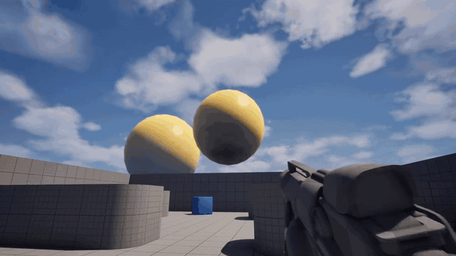

# BulletSystem

Physically simulated ballistics for Unreal Engine 5, with a replicated weapon and first-person sway. It is a teaching prototype cut from my larger FPS project, and one of my public code samples.

## What it does

- **Simulation:** each bullet advances in 10 ms sub-steps, with drag, gravity and wind. Drag follows `½·Cd·ρ·A·v²`, and speed is tracked in m/s while positions stay in centimeters.
- **Wind:** reads `AWindDirectionalSource` and computes drag from the velocity relative to the air.
- **Hits:** a complex trace on every sub-step, with a material probe to resolve the surface.
- **Penetration:** driven by surface type, impact angle and speed. A reverse trace finds the exit point.
- **Ricochet:** reflects the bullet while it still holds at least 10% of its muzzle energy.
- **Damage:** scales with remaining energy, and applies a physics impulse and strain on Geometry Collections.
- **Pooling:** keeps 100 bullets per class and returns them to the pool when their lifespan ends.
- **Weapon:** fire loop by RPM, server-driven state and a physics drop.
- **Sway:** owner-only first-person sway with spring solvers, clamps and decay.

## Networking

The bullet itself is not replicated. Every machine that spawns one simulates it locally:

1. The owning client spawns its bullet right away and calls `ServerPerformSpawnBullet`.
2. The server stores `BulletSpawnData`.
3. Remote clients spawn a cosmetic bullet from `OnRep`.

Equipped slot and firing state come from the server. The sample focuses on ballistics, so it has no health system, and damage runs on the shooter's client.

## Where to read

| File | Content |
|---|---|
| [`BSProjectile.cpp`](Plugins/BS_Weapon/Source/BS_Weapon/Private/BSProjectile.cpp) | Simulation, hit handling, penetration, ricochet and damage |
| [`BSWeapon.cpp`](Plugins/BS_Weapon/Source/BS_Weapon/Private/BSWeapon.cpp) | Fire loop and replicated weapon state |
| [`BSWeaponSwayComponent.cpp`](Plugins/BS_Weapon/Source/BS_Weapon/Private/BSWeaponSwayComponent.cpp) | First-person sway |
| [`BSWorldSettings.cpp`](Plugins/BS_Weapon/Source/BS_Weapon/Private/BSWorldSettings.cpp) | Bullet pool |
| [`BSWeaponSettings.h`](Plugins/BS_Weapon/Source/BS_Weapon/Public/BSWeaponSettings.h) | Penetration data per surface type |
| [`BulletSystemCharacter.cpp`](Source/BulletSystem/Private/BulletSystemCharacter.cpp) | Local bullet spawn and the replicated spawn struct |

## Run

1. Clone the repository. It is about 1 GB, because it includes the demo content.
2. Open `BulletSystem.uproject` in Unreal Engine 5.5 and build when asked.
3. Press Play.

Useful console variables:

- `BS.DebugVisualBulletEnabled 1` draws the bullet path.
- `BS.DebugBulletPoolEnabled 1` shows the pool state.

## Author

Henrique Tornelli, Senior Gameplay Programmer. Portfolio: [tornellihenrique.github.io](https://tornellihenrique.github.io/)
